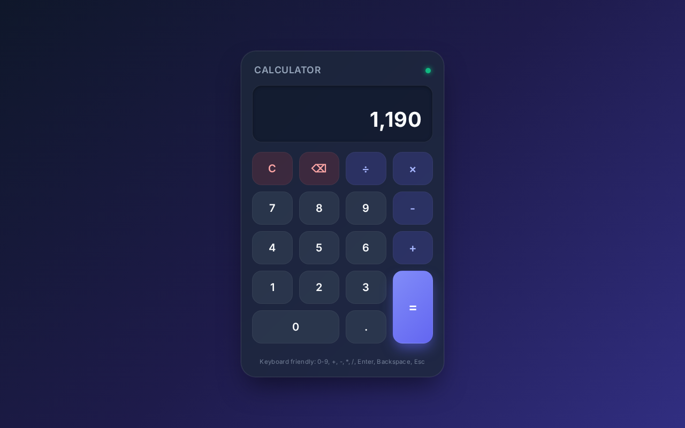

# Modern Calculator Web Application

A clean, attractive, and beginner-friendly Calculator Web Application built with semantic HTML5, modern CSS3, and vanilla JavaScript.



## ✨ Features

- **Modern UI & Aesthetic Design**: Clean glassmorphism / neomorphic dark card interface with vivid accent colors and soft drop shadows.
- **Responsive Layout**: Seamlessly adapts across mobile devices, tablets, and desktop displays.
- **Arithmetic Operations**:
  - Addition (`+`)
  - Subtraction (`-`)
  - Multiplication (`×`)
  - Division (`÷`)
- **Key Functionalities**:
  - Numbers `0` through `9`
  - Decimal support (`.`) with duplicate decimal prevention
  - Delete / Backspace (`⌫`) to remove the most recent entry
  - Clear (`C`) to reset the calculation
  - Equals (`=`) to evaluate the expression
  - Dual-line display showing current input as well as previous operand and active operator
- **Safe Error Handling**:
  - Gracefully handles division by zero with a friendly message: `"Cannot divide by zero"`.
  - Floating-point accuracy handling (e.g. `0.1 + 0.2 = 0.3` instead of `0.30000000000000004`).
- **Full Keyboard Support**:
  - Type numbers, operators, Enter, Backspace, or Escape directly from your keyboard with visual button feedback.

---

## ⌨️ Keyboard Shortcuts

| Key | Calculator Action |
| --- | --- |
| `0` - `9` | Enter digits |
| `.` | Enter decimal point |
| `+` | Addition |
| `-` | Subtraction |
| `*` | Multiplication (`×`) |
| `/` | Division (`÷`) |
| `Enter` or `=` | Calculate result (`=`) |
| `Backspace` | Delete last digit (`⌫`) |
| `Escape` or `c` / `C` | Clear all (`C`) |

---

## 🚀 How to Run the Project

This is a pure frontend application with no heavy dependencies or build steps required.

### Method 1: Open Directly in a Browser
Simply double-click the `index.html` file or open it in your preferred web browser (Chrome, Firefox, Safari, Edge):

```bash
# On Linux
xdg-open index.html

# On macOS
open index.html

# On Windows
start index.html
```

### Method 2: Run with Python Built-in Server
If you prefer running via a local HTTP server:

```bash
# Python 3
python3 -m http.server 8000
```
Then visit [http://localhost:8000](http://localhost:8000) in your browser.

### Method 3: Run with Node.js `npx serve`
```bash
npx serve .
```

---

## 📁 Project Structure

```
.
├── index.html       # Clean semantic HTML markup with accessibility features
├── style.css        # Responsive CSS styles with modern color palette and animations
├── script.js        # Calculator logic, state management, and keyboard event handlers
└── README.md        # Documentation and running instructions
```

---

## 🧪 Testing

Automated Playwright tests can be run to verify all arithmetic operations, edge cases (division by zero, decimal formatting), and responsiveness:

```bash
python3 verify_calculator.py
```
